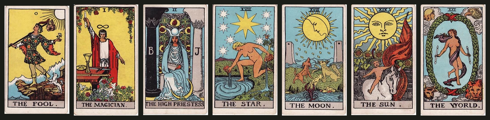
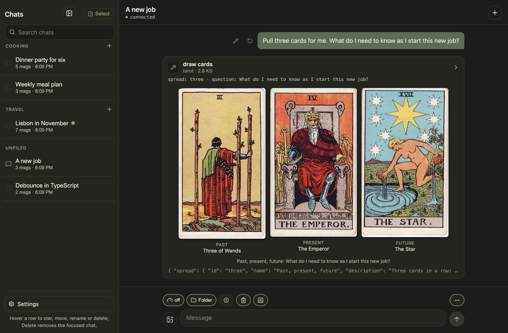
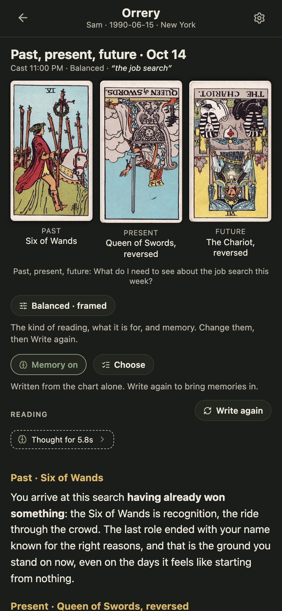
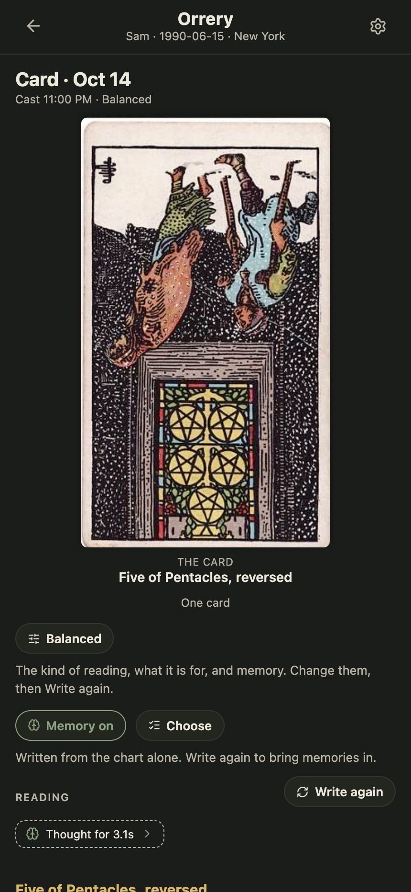

# tarot-mcp



Tarot readings for a local model: a small MCP server that LM Studio (or any
MCP host) launches over stdio. It shuffles the Rider-Waite-Smith deck, deals
a spread, and hands the model each card with its position, its orientation,
its keywords and its meaning that way up. The reading itself is the model's
to give.

## Tools

- `draw_cards` deals a spread for a question: `single`, `three` (past,
  present, future), `situation` (situation, obstacle, advice),
  `celtic-cross` (ten cards), or a number from 1 to 21 for a plain row.
  Reversals are on unless turned off. The result carries a `seed`, and the
  same seed deals the same reading again.
- `card_meaning` looks one card up by name or id: keywords and meaning
  upright and reversed, and what is in the picture.
- `list_spreads` names the spreads and what each position asks.

The tool descriptions, and a `guidance` field in every result, tell the
model how to read: the cards together, in the light of the question and the
positions; trauma-informed and expansive, leading with safety, choice and
agency; a reversal as a shading of the card rather than its opposite; and
never as a prediction. A position about what is ahead describes what is
opening up or wants attention, not what will happen.

## The pictures

Every card's picture is a resource, `tarot://card/<id>`, served as JPEG
from `deck/`. The ids are `major-00` to `major-21`, and `wands-01` to
`wands-14` (11 page, 12 knight, 13 queen, 14 king) and the same for `cups`,
`swords` and `pentacles`. The 1909 illustrations by Pamela Colman Smith are
in the public domain; `npm run fetch-deck` fetches them from Wikimedia
Commons, and the copies in `deck/` are those scans at 300 pixels wide.

[LM Chat](https://github.com/akuttruff/lm-chat) draws a `draw_cards` result
as its spread, the cards laid as they fell, from its own copy of the deck.

## In use

In [LM Chat](https://github.com/akuttruff/lm-chat), a `draw_cards` result is
laid out as its spread, each card under its position, and the model's
reading follows:



<table>
  <tr>
    <td align="center" valign="top" width="33%"><br /><sub>The same draw on a phone, with the reading under it.</sub></td>
    <td align="center" valign="top" width="33%"><br /><sub>In <a href="https://github.com/akuttruff/orrery">Orrery</a>, a spread cast from the home screen.</sub></td>
    <td align="center" valign="top" width="33%"><br /><sub>A daily card in Orrery.</sub></td>
  </tr>
</table>

## Setup

Node 22 or newer.

```sh
npm install
npm run build
npm test
```

In LM Studio's `mcp.json`:

```json
"tarot": { "command": "node", "args": ["/path/to/tarot-mcp/dist/index.js"] }
```
